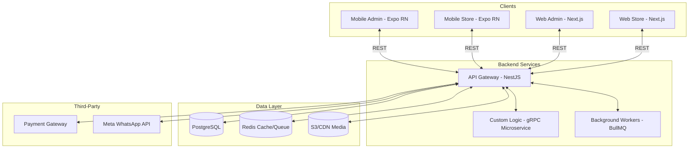
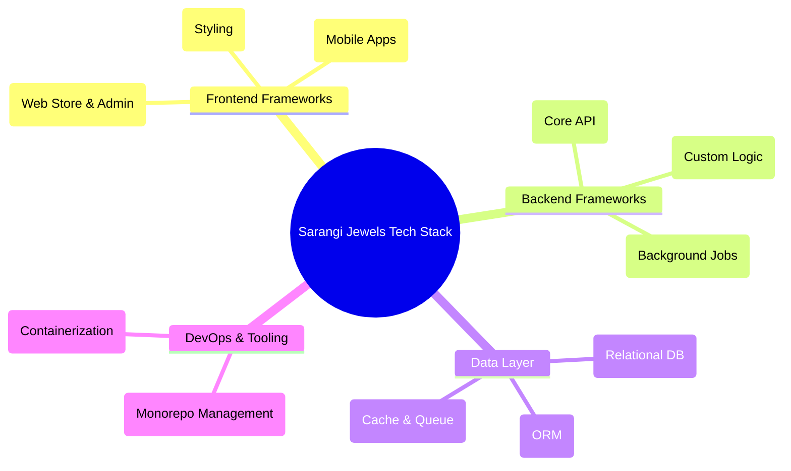
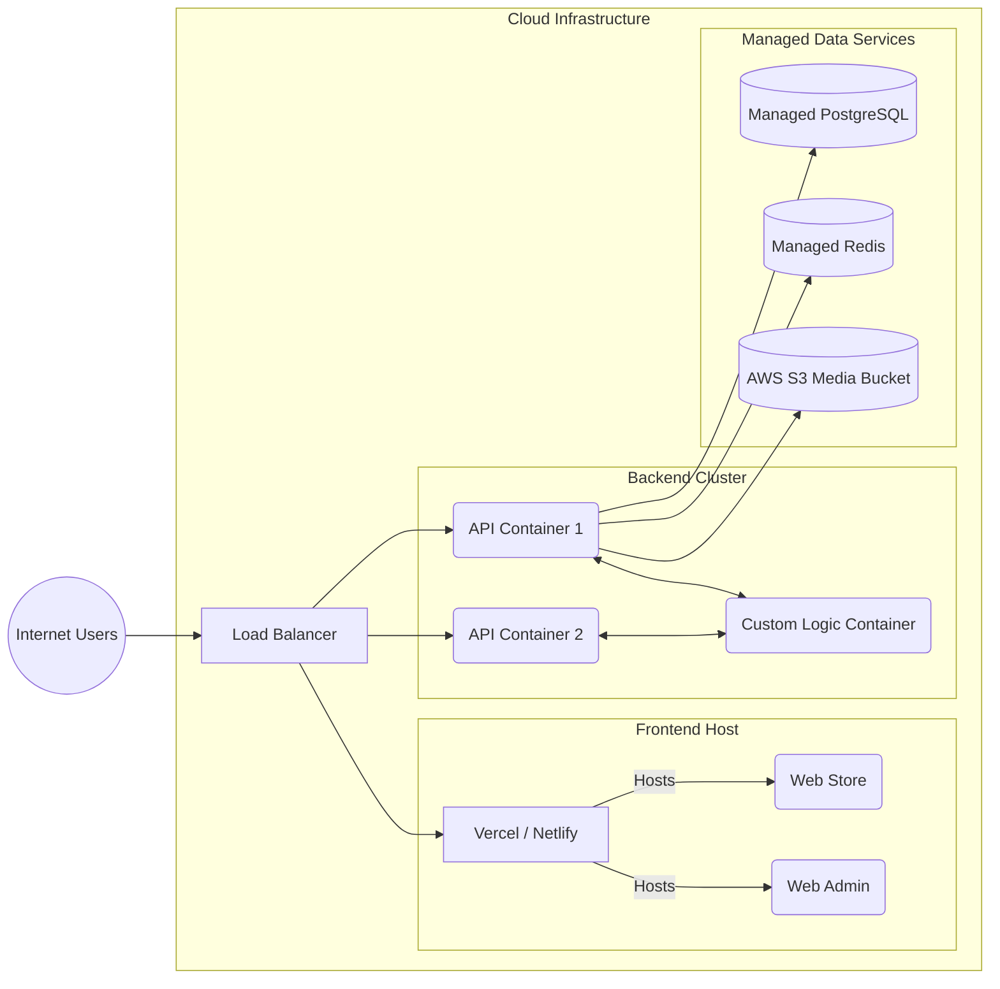
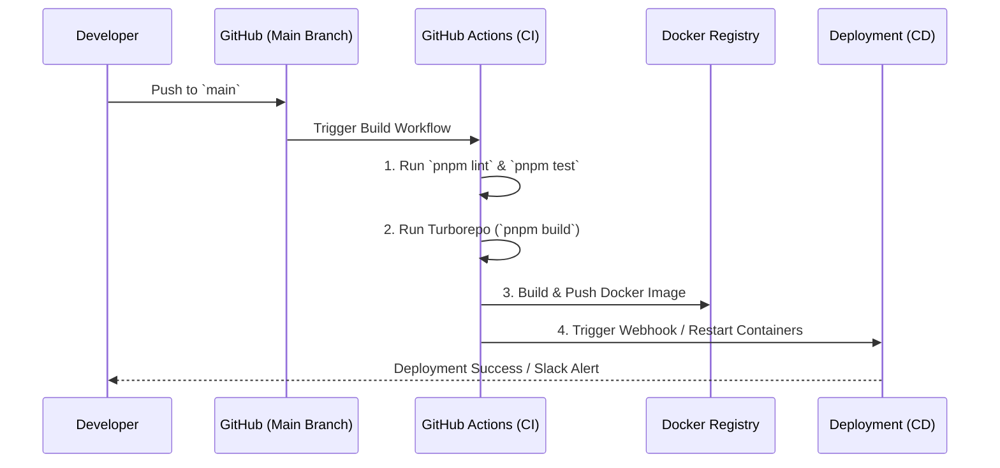
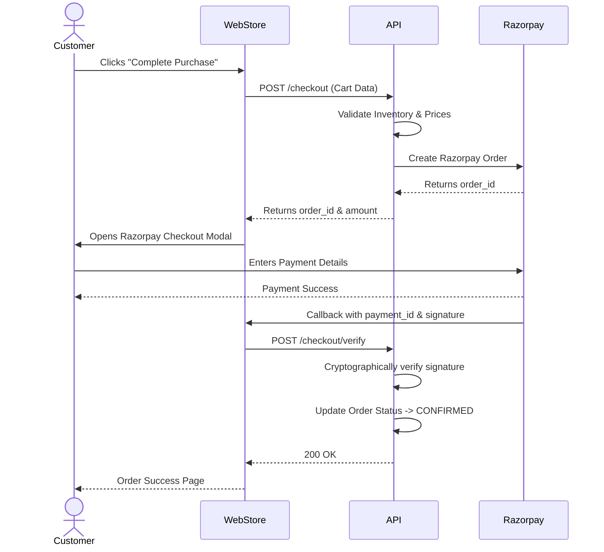
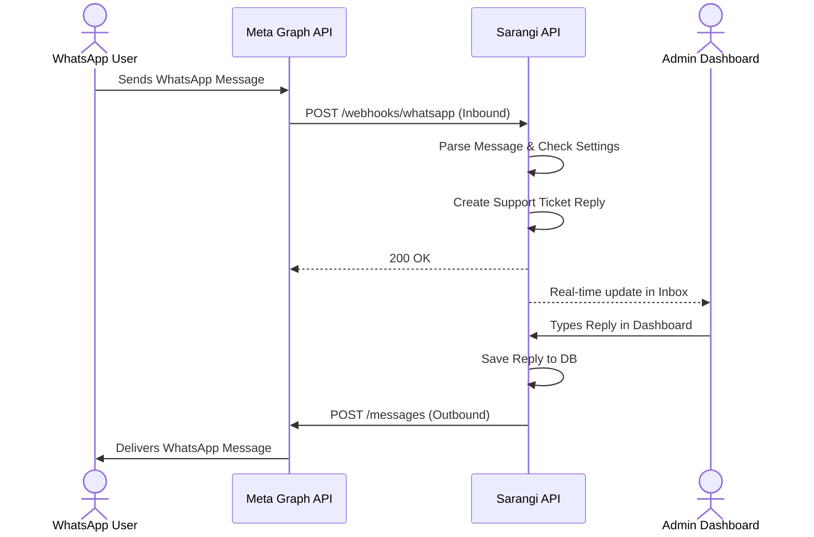
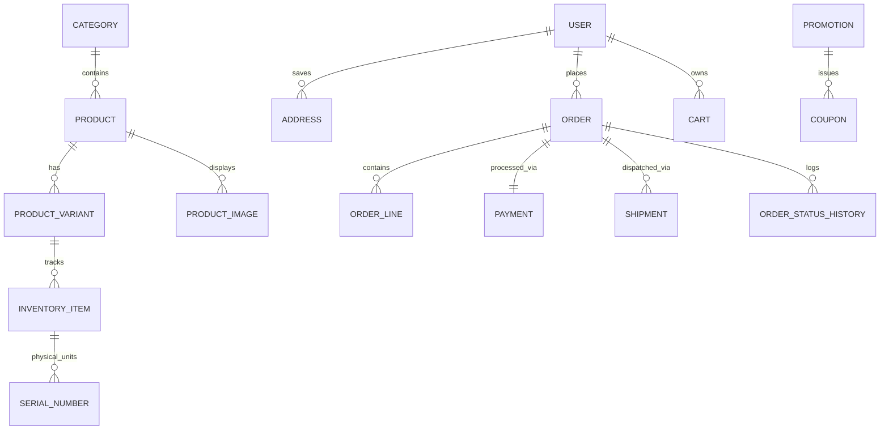
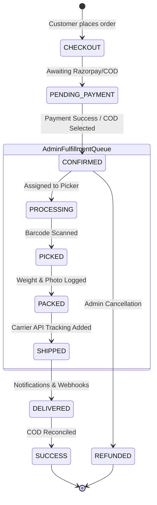

# Sarangi Jewels — Platform Architecture

Online brand store for fine jewellery, ladies accessories, care products, pendants, and related catalog. One backend serves customer web, customer mobile, admin web, and admin mobile so catalog, pricing, inventory, and orders are centrally controlled.

---

## 1. High-level system view



**Principle:** Mobile and web are thin clients. Business rules, inventory, orders, and admin permissions live only in `apps/api` and `apps/custom-logic` microservices. Admin changes propagate to all clients on the next API call (and via push/WebSocket where needed). This ensures strict consistency across the entire eCommerce ecosystem.

---

## 2. Platform Frameworks & Tech Stack



| Layer | Choice | Rationale |
|-------|--------|-----------|
| Monorepo | **pnpm** + **Turborepo** | Shared types, one CI pipeline, fast builds |
| API | **NestJS** (TypeScript) | Modules map to domains; guards, DI, jobs |
| Customer web | **Next.js 15** (App Router) | SEO for products, SSR, image optimization |
| Admin web | **Next.js 15** (separate app) | Different auth, layout, no SEO noise |
| Mobile (store + admin) | **Expo** (React Native) | OTA updates, shared TS with web packages |
| DB | **PostgreSQL** | Orders, inventory, relational catalog |
| Cache / sessions | **Redis** | Cart sessions, rate limits, job queues |
| Search (phase 2) | **Meilisearch** or PG full-text | Faceted jewellery search |
| Media | **S3-compatible** + CDN | High-res product imagery |
| Payments | **Stripe** or **Razorpay** (region) | PCI scope minimized via provider |
| Push (mobile) | **FCM** + Expo Notifications | Order status, promos |
| Email / SMS | **Resend** / **Twilio** | Order confirmations, shipping |

---

## 3. Platform & Deployment Architecture

The system is designed to be cloud-agnostic and containerized, allowing deployment across AWS, GCP, or managed PaaS platforms like Fly.io.



- **Frontend Hosting:** Vercel or Netlify is recommended for Next.js to leverage Edge caching and Server-Side Rendering (SSR).
- **Backend Hosting:** Docker containers running on AWS Fargate, Google Cloud Run, or Fly.io. The `apps/api` scales horizontally behind a load balancer.
- **Microservices:** The `custom-logic` gRPC service sits within the same private network, isolated from public internet traffic.

### 3.1 CI/CD Pipeline & Load Balancing Strategy

To ensure zero-downtime deployments and high availability, the platform relies on automated CI/CD and intelligent load balancing.

#### CI/CD Pipeline (GitHub Actions)

*Because the project is a monorepo, **Turborepo** intelligently determines which apps changed (e.g., if only `web-store` changed, it skips building the `api`), drastically reducing deployment times.*

#### Load Balancing & Horizontal Scaling
- **Traffic Routing:** An AWS Application Load Balancer (ALB) or NGINX ingress controller acts as the entry point. It terminates SSL/TLS and inspects the request paths.
- **API Auto-Scaling:** As traffic spikes (e.g., during a flash sale), the container orchestration platform (AWS ECS/K8s) spins up additional replica containers of the `api`.
- **Statelessness:** The NestJS API is completely stateless. Session data and carts are stored in **Redis**, meaning a user's request can hit `API Container 1` and their next request can hit `API Container 2` without losing their login state.

---

## 4. Third-Party Integrations

### 4.1 Razorpay Payment Gateway Integration

The checkout process utilizes a secure, server-side verified payment flow with Razorpay.



### 4.2 Meta WhatsApp Business API Integration

The CRM integrates a bidirectional messaging pipeline with WhatsApp.



---

## 5. Repository folder structure

```
noeve/                              # repo root (this Code/ directory)
├── apps/
│   ├── api/                        # Single backend — source of truth
│   ├── web-store/                  # Customer storefront (Next.js)
│   ├── web-admin/                  # Admin dashboard (Next.js)
│   ├── mobile-store/               # Customer app (Expo)
│   └── mobile-admin/               # Ops app: pick/pack/ship (Expo)
│
├── packages/
│   ├── shared-types/               # DTOs, enums, API response shapes
│   ├── validation/                 # Zod schemas (shared api ↔ clients)
│   ├── api-client/                 # Typed fetch wrapper + React Query hooks
│   ├── ui-tokens/                  # Colors, typography, spacing (brand)
│   ├── ui-web/                     # Shared React components (web only)
│   ├── ui-native/                  # Shared RN primitives
│   ├── config-eslint/              # Shared lint config
│   └── config-typescript/          # Base tsconfig
│
├── infrastructure/
│   ├── docker/                     # docker-compose for local dev
│   ├── migrations/                 # Optional: central SQL if not in api/
│   └── scripts/                    # seed, backup, deploy helpers
│
├── docs/
│   ├── ARCHITECTURE.md             # This file
│   ├── SYSTEM_ARCHITECTURE_AND_TECHNOLOGIES.md # Detailed tech stack and system frameworks
│   ├── HORIZONTAL_SCALING.md       # Guidelines for horizontal scaling and load balancers
│   ├── USER_MANUAL.md              # User and Admin Manual
│   ├── api/                        # OpenAPI exports, ADRs
│   └── runbooks/                   # Fulfillment, incident playbooks
│
├── .github/workflows/              # CI: lint, test, build per app
├── turbo.json
├── pnpm-workspace.yaml
├── package.json
└── README.md
```

### 3.1 `apps/api` — backend layout (domain-driven modules)

```
apps/api/
├── src/
│   ├── main.ts
│   ├── app.module.ts
│   ├── common/                     # Filters, pipes, decorators, guards
│   │   ├── guards/
│   │   │   ├── jwt-auth.guard.ts
│   │   │   └── roles.guard.ts      # CUSTOMER | ADMIN | FULFILLMENT
│   │   └── interceptors/
│   │
│   ├── modules/
│   │   ├── auth/                   # Login, refresh, OTP, social (optional)
│   │   ├── users/                  # Profiles, addresses
│   │   ├── catalog/                # Categories, products, variants, media
│   │   ├── inventory/              # Stock levels, reservations
│   │   ├── cart/                   # Guest + authenticated carts
│   │   ├── checkout/               # Shipping, tax, payment intents
│   │   ├── orders/                 # Order lifecycle, history
│   │   ├── fulfillment/            # Pick lists, packing, carriers, tracking
│   │   ├── payments/               # Webhooks from Stripe/Razorpay
│   │   ├── promotions/             # Coupons, campaigns
│   │   ├── notifications/        # Email, SMS, push templates
│   │   ├── admin/                  # Aggregated admin queries & audits
│   │   └── analytics/              # Sales dashboards (admin)
│   │
│   ├── jobs/                       # BullMQ workers (emails, stock sync)
│   └── config/                     # env validation (Zod)
│
├── prisma/                         # or TypeORM migrations
│   └── schema.prisma
└── test/
```

### 3.2 `apps/web-store` — customer web

```
apps/web-store/
├── src/
│   ├── app/                        # App Router
│   │   ├── (shop)/                 # Layout: header, cart drawer
│   │   │   ├── page.tsx            # Home / featured collections
│   │   │   ├── collections/[slug]/
│   │   │   ├── products/[slug]/
│   │   │   ├── cart/
│   │   │   └── checkout/
│   │   ├── account/                # Orders, addresses, wishlist
│   │   └── api/                    # BFF routes only if needed (rare)
│   ├── components/
│   │   ├── product/
│   │   ├── cart/
│   │   └── layout/
│   ├── lib/
│   │   ├── api.ts                  # uses @noeve/api-client
│   │   └── auth.ts
│   └── styles/
└── public/
```

### 3.3 `apps/web-admin` — admin web

```
apps/web-admin/
├── src/
│   ├── app/
│   │   ├── (auth)/login/
│   │   └── (dashboard)/
│   │       ├── orders/             # List, detail, status transitions
│   │       ├── fulfillment/        # Queue, assign, print labels
│   │       ├── products/           # CRUD, bulk import, images
│   │       ├── inventory/
│   │       ├── customers/
│   │       ├── promotions/
│   │       └── settings/           # Shipping zones, tax, brand
│   ├── components/
│   │   ├── orders/
│   │   └── data-table/             # Sortable filters for ops
│   └── lib/
│       └── permissions.ts          # UI mirrors API roles
```

### 3.4 `apps/mobile-store` — customer mobile

```
apps/mobile-store/
├── app/                            # Expo Router file-based routes
│   ├── (tabs)/
│   │   ├── index.tsx               # Home
│   │   ├── shop.tsx                # Categories
│   │   ├── cart.tsx
│   │   └── account.tsx
│   ├── product/[id].tsx
│   ├── checkout/
│   └── orders/[id].tsx             # Tracking
├── src/
│   ├── components/
│   ├── hooks/                      # useCart, useAuth from api-client
│   ├── services/                   # SecureStore tokens, push registration
│   └── theme/                      # from @noeve/ui-tokens
└── app.json
```

### 3.5 `apps/mobile-admin` — warehouse / ops mobile

```
apps/mobile-admin/
├── app/
│   ├── (auth)/
│   ├── orders/                     # Scan barcode → open order
│   ├── fulfill/[orderId].tsx       # Mark picked, packed, handed to carrier
│   └── scan.tsx                    # Camera / barcode for SKU & AWB
└── src/
    └── offline/                    # Optional: queue status updates offline
```

---

## 4. API design — how clients stay in sync

### 4.1 Versioning and contract

- Base path: `https://api.noeve.com/v1`
- OpenAPI spec generated from NestJS → published to `docs/api/openapi.yaml`
- **`@noeve/shared-types`** and **`@noeve/validation`** generated or hand-maintained from the same Zod schemas the API uses

### 4.2 Audience-specific routes (same backend)

| Prefix | Used by | Purpose |
|--------|---------|---------|
| `/v1/store/*` | web-store, mobile-store | Catalog, cart, checkout, customer orders |
| `/v1/admin/*` | web-admin, mobile-admin | Products, inventory, all orders, fulfillment |
| `/v1/webhooks/*` | Payment/shipping providers | Signed callbacks only |

Guards enforce **role + scope**: a customer token cannot call `/admin/orders`.

### 4.3 Central control flows

1. **Catalog** — Admin creates/updates product → API persists → CDN cache bust → clients refetch or receive push topic `catalog_updated`.
2. **Inventory** — Stock reserved at checkout; admin adjustments in `inventory` module; oversell prevented in API only.
3. **Orders** — Single `orders` table with state machine; admin and customer see consistent status via same `orderId`.
4. **Fulfillment** — Transitions: `CONFIRMED → PROCESSING → PICKED → PACKED → SHIPPED → DELIVERED` (configurable). Mobile-admin scans drive transitions; web-admin shows full timeline.
5. **Notifications** — API emits events → `notifications` module → email/SMS/push; mobile registers device token linked to `userId`.

### 4.4 Real-time (optional but valuable)

- **WebSocket** namespace `/ws/orders/:orderId` for live tracking (customer apps).
- **Admin dashboard** subscribes to `order.created`, `order.status_changed` for live queue counts.

---

## 5. Data model (core entities)



**Jewellery & Rental specific fields:** 
- **Product/Variant:** material, purity (e.g. 18K), gemstone, weight, care instructions, certificate URL, collection tag (e.g. pendants, care-accessories).
- **Rentals:** `SERIAL_NUMBER` tracks individual physical units. Orders block out `startDate` and `endDate` against these specific serials to prevent double-booking.

---

## 6. Authentication and authorization

| Actor | Method | Notes |
|-------|--------|-------|
| Customer (web/mobile) | Email/password + optional OTP; refresh tokens in httpOnly cookie (web) or SecureStore (mobile) | Same `users` table |
| Admin | Separate login on `web-admin` / `mobile-admin`; MFA recommended | Role-based access |
| API | JWT access (short) + refresh (long); rotate on use | |

Roles: `CUSTOMER`, `ADMIN`, `FULFILLMENT`, `SUPPORT`. NestJS `@Roles()` + policy checks on order transitions (e.g. only `FULFILLMENT` can set `SHIPPED`).

---

## 7. Order fulfillment architecture



**Idempotency:** Payment and webhook handlers use idempotency keys to ensure multiple pings do not duplicate orders. Status transitions validate allowed edges server-side (e.g., an order cannot jump from `CONFIRMED` to `DELIVERED` without a tracking number in `SHIPPED`).

---

## 8. Cross-cutting concerns

| Concern | Approach |
|---------|----------|
| i18n / currency | Store in user/session; prices in DB in minor units (cents/paise) |
| SEO | web-store SSR product pages, structured data (Product JSON-LD) |
| Images | Multiple resolutions; lazy load; watermark optional for catalogue |
| Security | HTTPS only, CSP on web, certificate pinning (mobile, phase 2) |
| Observability | OpenTelemetry in API; Sentry on all apps |
| CI/CD | Turborepo affected builds; deploy api + web separately; EAS for mobile |

---

## 9. Environment topology

| Environment | Purpose |
|-------------|---------|
| `local` | docker-compose: Postgres, Redis, MinIO, api, web-store |
| `staging` | Full stack; test payments |
| `production` | API on containers (Fly.io/AWS/GCP); Vercel or similar for Next.js; EAS production mobile |

---

## 10. Phased delivery

| Phase | Scope |
|-------|--------|
| **MVP** | api + web-store + web-admin: catalog, cart, checkout, order list, manual fulfillment status |
| **Phase 2** | mobile-store, payments live, email notifications |
| **Phase 3** | mobile-admin scanning, push tracking, promotions |
| **Phase 4** | Search, analytics, multi-warehouse, loyalty |

---

## 11. Why this architecture fits Sarangi Jewels

- **One API** — Admin updates products once; web and mobile customers see the same catalog and prices without duplicate backends.
- **Monorepo** — Shared validation prevents mobile/web drift; faster feature delivery for jewellery-specific fields.
- **Split admin vs store apps** — Security (admin not on public domain), performance, and clearer UX for operations staff.
- **Fulfillment on mobile** — Warehouse staff use phones for scan-to-ship while managers use web-admin for overview and reporting.

---

## 12. Next steps

1. Initialize monorepo (`pnpm init`, Turborepo, workspace packages).
2. Scaffold `apps/api` with `auth`, `catalog`, `orders` modules and Prisma schema.
3. Define OpenAPI + `@noeve/shared-types` from day one.
4. Build web-store MVP, then web-admin order queue, then mobile apps against frozen API v1.

## 13. Credentials
PostgreSQL Seed complete.
  Admin:    admin@noeve.local / Admin123!
  Customer: customer@noeve.local / Customer123!


## 14. Modern Upgrades (Phase 5+)
- **Microservices & gRPC**: The monolithic API has been extended to support high-performance microservices (TCP/Redis/gRPC transport) inside the `@noeve/custom-logic` module. This allows custom business logic to scale independently.
- **WhatsApp CRM**: Integrated Meta Graph API bidirectional messaging. Inbound WhatsApp messages are parsed via webhook into the Inbox/Support system. Admin replies auto-dispatch outbound messages to customers.
- **Rental & Makeup Booking**: Advanced inventory control allowing date-based bookings (start/end dates) mapped to physical serial numbers, blocking stock across calendars.
- **Atomic Design System**: Web-store fully migrated to an atomic components architecture (`src/components/atomic/`) encapsulating logic and presentation into Molecules and Organisms.
- **Blog CMS**: Fully integrated markdown/HTML rich-text blogging platform with SEO metadata and community commenting engine (approval/rejection moderation).
