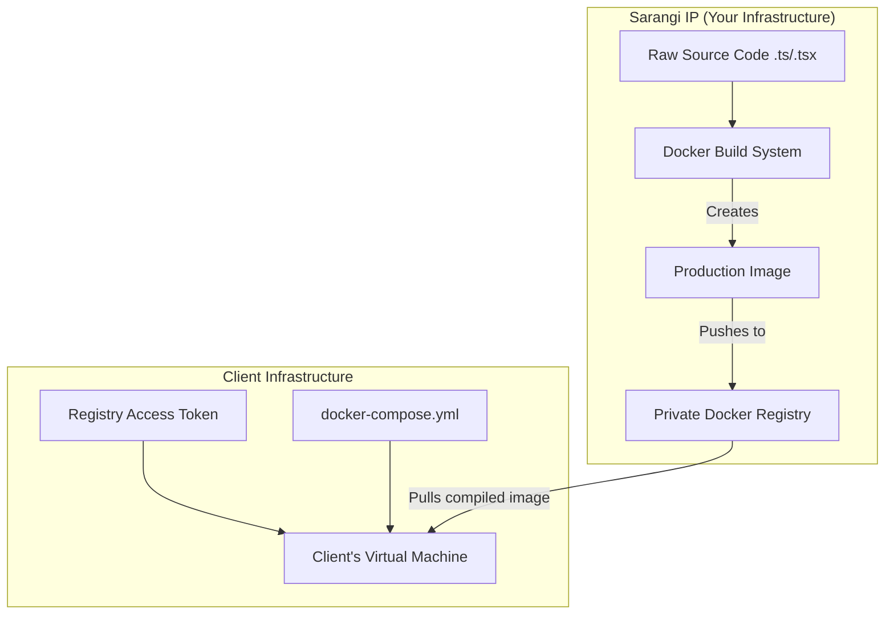
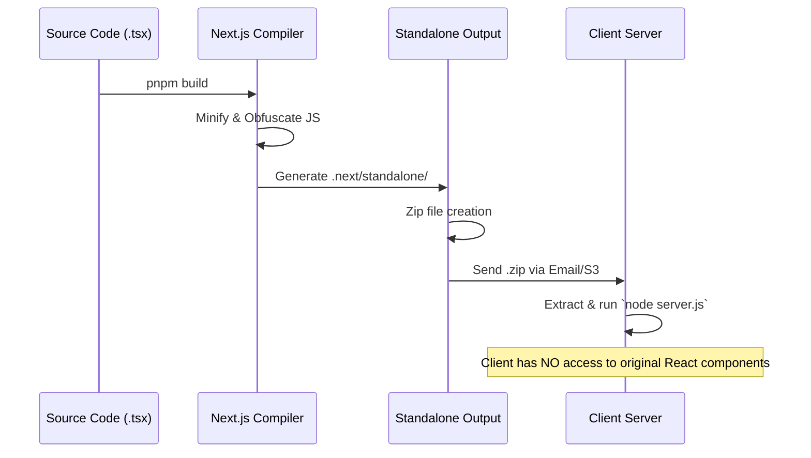
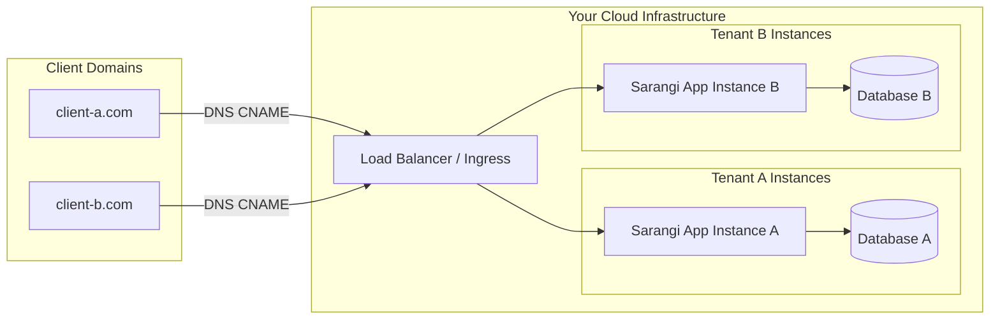

# Client Delivery Model (Source Code Protection)

As the proprietor of the Sarangi Jewels eCommerce platform, your source code is your intellectual property. When delivering the software to clients (B2B, white-labeling, or licensing), you **must never provide the raw `.ts` or `.tsx` source code**. 

Instead, you should provide pre-compiled, production-ready artifacts that run the application but cannot be easily read or modified by the client.

Here are the industry-standard strategies for delivering the software to your clients while protecting your IP:

---

## Strategy 1: Docker Containers (Recommended)

Docker is the most secure and professional way to deliver the application. You compile the application into a "Docker Image" on your machine, push it to a private registry, and the client pulls the image to run it.

### Workflow:
1. **Build the Images locally:**
   You create Dockerfiles for the API (`apps/api`), the Web Store (`apps/web-store`), and the Web Admin (`apps/web-admin`).
   These Dockerfiles will run `pnpm build` and only copy the compiled `dist/` or `.next/` folders into the final image, completely discarding the raw source code.

2. **Push to a Private Registry:**
   Push these images to a private registry (like Docker Hub Pro, AWS ECR, or GitHub Container Registry).

3. **Client Delivery:**
   You provide the client with a `docker-compose.yml` file and a "Deploy Token" (read-only access to your registry).
   The client runs `docker-compose up -d`. The application runs on their server, but they never see your source code.

---

## Strategy 2: Next.js Standalone Build (For Frontend)

Next.js has a built-in feature called `output: 'standalone'` (configured in `next.config.js`). 

When you run `pnpm build`, Next.js automatically traces all necessary dependencies and creates a highly optimized, self-contained Node.js server in the `.next/standalone/` folder.

### Workflow:
1. Enable `output: 'standalone'` in `apps/web-store/next.config.js` and `apps/web-admin/next.config.js`.
2. Run the build command (`pnpm build`).
3. Zip the `.next/standalone` folder along with the `.next/static` and `public` folders.
4. Send this ZIP file to the client.
5. The client extracts the ZIP and simply runs `node server.js`. 
**Result:** They can run the frontend, but the code inside is minified, obfuscated, and compiled JavaScript. The original React/TypeScript code is completely gone.

---

## Strategy 3: SaaS / Managed Hosting Model (Most Secure)

The ultimate way to protect your intellectual property and guarantee recurring royalties is to **never give the client the software at all**.

### Workflow:
Instead of sending files to the client, you host the application on your own cloud infrastructure (e.g., AWS, Vercel, or a VPS).
1. The client points their domain name (e.g., `shop.client-domain.com`) to your server's IP address.
2. You spin up an instance of the database and the application for them.
3. You charge them a monthly/yearly licensing fee and a hosting fee.

**Benefits:**
- **Zero Risk of IP Theft:** The client never has access to the server or any files.
- **Recurring Revenue:** It is much easier to enforce royalties and subscription fees when you control the hosting.
- **Easy Updates:** When you improve the software, you can push the update to all clients instantly.

---

## Strategy 4: Obfuscation & Bundling (For the API)

If the client explicitly demands to host the API themselves on a bare-metal server (without Docker), you can compile the NestJS API into a single obfuscated JavaScript file.

### Workflow:
1. Use a bundler like **Webpack** or **esbuild** to bundle the entire NestJS application into a single `main.js` file.
2. Run an obfuscator (like `javascript-obfuscator`) on the `main.js` file to scramble the variables and logic, making it nearly impossible to reverse-engineer.
3. Deliver only the obfuscated `main.js` file, the `package.json` (with only production dependencies), and the Prisma schema (needed for database migrations).
4. The client runs `node main.js`.

---

## Summary Checklist for Client Delivery

- [ ] **NEVER** share the `.git` directory.
- [ ] **NEVER** share the `src/` directories.
- [ ] **NEVER** share the `.env` file containing your personal secret keys. Provide them with a `.env.example` template to fill in their own keys.
- [ ] **ALWAYS** use compiled outputs (`dist`, `.next/standalone`) or Docker images.
- [ ] **ALWAYS** have a legally binding Software Licensing Agreement (SLA) stating that reverse engineering or distributing the software is strictly prohibited.
