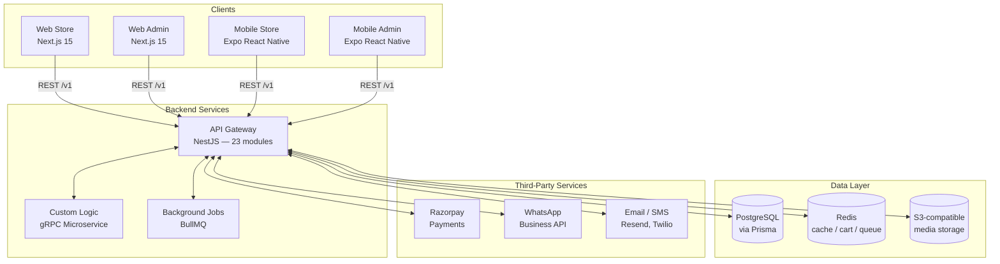
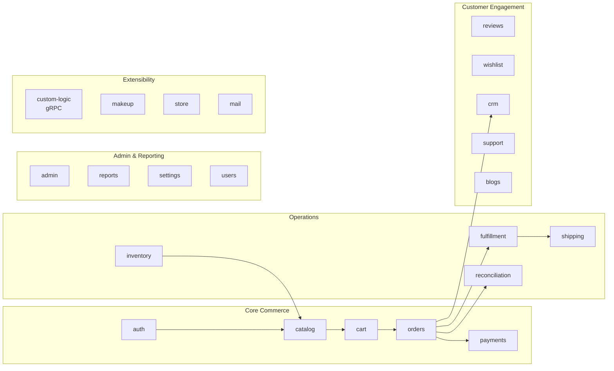
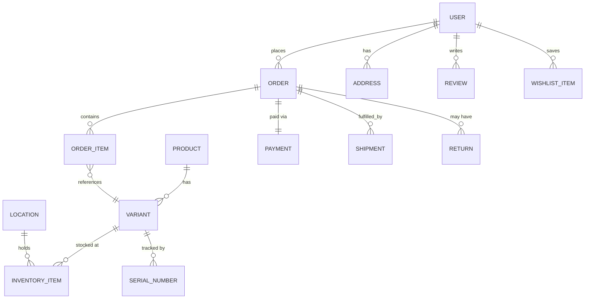
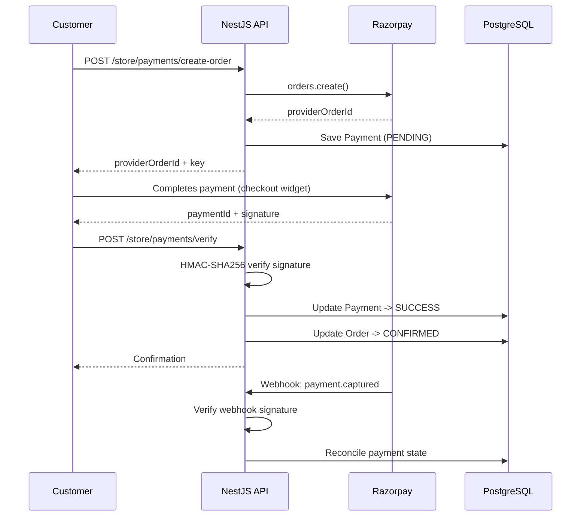
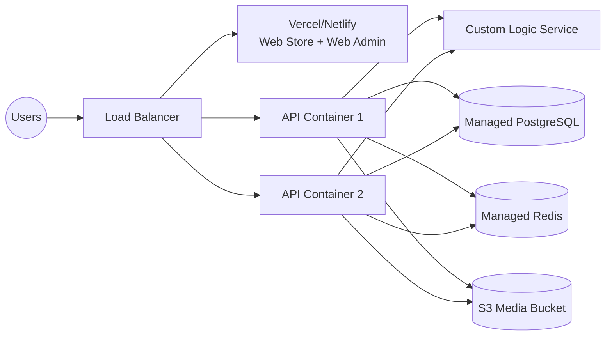

# Sarangi Jewels Platform — Code Audit & Architecture Report
Prepared 12 September 2026 · Based on direct inspection of the supplied codebase (`sarangi-ecom`)

---

## Part A — Architecture Document

### A.1 System Overview

The platform is a pnpm/Turborepo monorepo with **one backend serving four client applications**, so business logic, pricing, and inventory state live in a single place.

**Principle:** clients are thin. All business rules — pricing, stock, order state, permissions — are enforced server-side in `apps/api`. An admin change is visible to every client on its next API call.

### A.2 Backend Module Map

The API is organized into 23 domain modules under `apps/api/src/modules`:

### A.3 Data Model (Key Entities)

The Prisma schema (678 lines) models retail and rental together rather than as separate systems:

Notable design choices:
- **Multi-location inventory** — stock is tracked per `Location`, not just a single global count, so a jewellery counter, apparel section, and rental stock room can be modeled as separate (or shared) locations.
- **Serial/batch tracking** — individual high-value items (e.g., a specific jewellery piece or costume) can be tracked by serial number, not just SKU-level counts.
- **Returns and shipments are first-class entities**, not status flags on the order.

### A.4 Payment Flow

This is a real, signature-verified integration on both the client-confirmation and webhook paths, with a documented mock/sandbox fallback (`isMockMode`) for local development or a client without live Razorpay keys yet.

### A.5 Deployment Topology (as documented in the repo)

The repo includes Docker Compose files for local and production infra, Nginx TLS config, and a GitHub Actions CI workflow — so this deployment path is not just theoretical, the supporting config exists in the codebase.

---

## Part B — Code Audit Findings

Findings are graded **Critical / High / Medium / Low** by real-world impact, based on direct code inspection (not just the project's self-reported status docs).

### B.1 Critical

None found. No hardcoded production secrets, no SQL injection surface (Prisma parameterizes queries throughout), no obviously exploitable authentication bypass.

### B.2 High

| Finding | Location | Detail |
|---|---|---|
| **Refresh token is not a real refresh token** | `apps/api/src/modules/auth/auth.service.ts` (`issueTokens`) | The returned `refreshToken` is the identical JWT as `accessToken`. There is no separate refresh-token secret, rotation, or revocation mechanism. Sessions cannot be silently renewed; the current 15-minute access-token expiry means users are logged out frequently, or the token lifetime has to be extended in a way that increases risk if a token is ever leaked. |
| **No rate limiting on any endpoint** | `apps/api/src/main.ts`, all controllers | No `@nestjs/throttler` (or equivalent) is registered. Login, OTP-request, and checkout endpoints can be hit at unlimited frequency, which is a real brute-force and abuse risk once the site is public. |
| **OTP delivery is mocked, not wired to a real provider** | `auth.service.ts` (`sendOtp`) | The OTP is generated and printed to the server console (`[MOCK SMS] Sending OTP...`) rather than sent via Twilio (which is a listed but unused dependency for this flow). Phone/OTP login is non-functional for real users until this is connected. |

### B.3 Medium

| Finding | Location | Detail |
|---|---|---|
| **No security-headers middleware** | `apps/api/src/main.ts` | No `helmet` (or manual equivalent) setting headers like `X-Content-Type-Options`, `Content-Security-Policy`, `Strict-Transport-Security`. CORS is configured correctly, but headers hardening is otherwise absent. |
| **Very thin automated test coverage** | repo-wide | Only 2 `*.spec.ts`/`*.test.ts` files were found despite ~28,000 lines of application code and a CI pipeline that runs `turbo run test`. Regressions in checkout, payments, or inventory logic would likely only be caught manually. |
| **Loose utility/debug scripts committed at repo root** | `/scratch.ts`, `/rewrite.js`, `/rewrite_payments.js`, `/rewrite-checkout.ts`, `/test-login.js`, `/test-orders.js`, `/test-db.js`, `/test-patch.js`, `/test-update.js`, `/test-webhooks.js`, `/get-inv.js`, `/update_orders.js`, `/update_schema.js`, `/populate_reports.js`, `/rename.js`, `/generate-tests.js` | These read as one-off developer scratch scripts, not part of the shipped applications. They should be reviewed and removed (or moved to a `/scripts/dev-only` folder with clear documentation) before any source-code handover, both for cleanliness and to confirm none contain stale logic that could be run against a live database by mistake. |
| **Self-reported completion status is optimistic in places** | `docs/WORK_TRACKER.md` | The tracker marks items like "Auth" and "Payments" as 100% done; the audit found real functional gaps within both (refresh tokens, OTP). This isn't dishonesty — internal trackers usually mean "the feature exists and mostly works" — but it shouldn't be repeated to a buyer as an unconditional guarantee without the caveats in this report. |

### B.4 Low

| Finding | Detail |
|---|---|
| **Search is filter-based, not a dedicated search engine** | Fine for the current catalog size; the architecture doc itself flags Meilisearch/full-text search as a future phase. |
| **No dedicated analytics/BI layer** | Reporting reads directly from the transactional database via a `reports` module; acceptable at this scale, but wouldn't scale gracefully to a much larger catalog/order volume without a read-replica or warehouse. |
| **Prisma pinned via pnpm override** | Reasonable defensive practice, but worth re-validating on any future dependency upgrade pass. |

### B.5 What's Solid (confirmed, not just claimed)

- **Password storage:** bcrypt with cost factor 12 — appropriate, not a weak default.
- **Input validation:** Zod schemas validate every auth/order input; NestJS `ValidationPipe` runs globally with `whitelist` and `forbidNonWhitelisted`, which rejects unexpected fields rather than silently accepting them.
- **Payment signature verification:** implemented correctly using HMAC-SHA256 on both the client-confirmation and webhook paths — this is the step many small e-commerce builds skip or implement incorrectly.
- **No live secrets committed:** `.env` and `.env.production` in the repo contain placeholder values only (verified directly — no real API keys, database passwords, or private keys found in tracked files).
- **HTTPS enforcement:** production requests are redirected to HTTPS via `trust proxy` + `x-forwarded-proto` checks, standard practice behind a load balancer.
- **Role-based access control:** distinct guards (`jwt-auth.guard.ts`, `roles.guard.ts`) separate customer, admin, fulfillment, and support permissions.

### B.6 Recommended Remediation Priority

1. **Before go-live:** wire real refresh-token issuance/rotation; add rate limiting (`@nestjs/throttler`) to auth and checkout routes; wire OTP to Twilio/SNS or disable phone login until it's connected.
2. **Before go-live:** add `helmet` for baseline security headers.
3. **Within first post-launch month:** expand automated test coverage for checkout, payment verification, and inventory-decrement logic — these are the flows where a silent bug costs real money.
4. **Housekeeping, low urgency:** remove or relocate the root-level scratch/debug scripts; reconcile `WORK_TRACKER.md` claims against actual behavior so future development sessions don't build on top of an inaccurate status page.

---

## Summary

The platform is a substantial, largely well-built system with real payment integration, a sound multi-tenant-ready data model, and no critical security defects. The gaps found are typical "last 10%" items for a project at this stage — session/token handling, rate limiting, OTP wiring, and test coverage — all addressable in a short, well-scoped follow-up engagement rather than signs of a fundamentally broken system.
