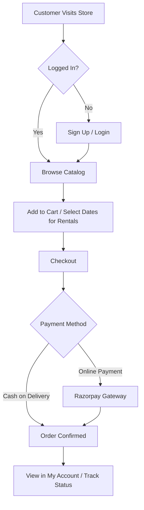
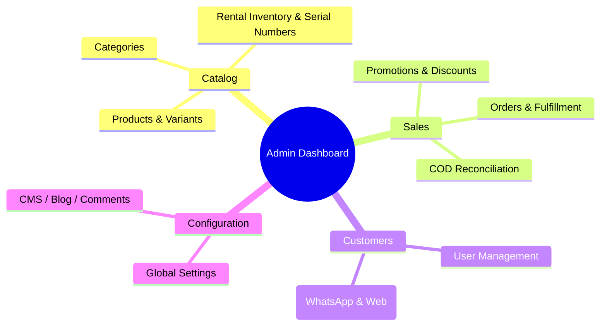

# Sarangi Jewels Store - Comprehensive User Manual

Welcome to the Sarangi Jewels Store! This manual provides an exhaustive, step-by-step guide on how to operate the various platforms within the Sarangi Jewels ecosystem. It is divided into two main sections: the Customer experience (Storefront) and the Administrator experience (Web Admin Dashboard).

---

## 1. For Customers (Web & Mobile Store)

### 1.1 Account & Order Workflow Overview

*The diagram above illustrates the standard customer journey. Whether a customer is making a standard purchase or placing a rental booking, they must flow through the secure checkout portal where their payment is validated before the order appears in their account dashboard.*

### 1.2 Creating an Account & Logging In
1. **Navigate to the Storefront:** Open the Sarangi Jewels website or mobile application.
2. **Access Account Page:** Click the "Account" or "Profile" icon in the top navigation bar.
3. **Register:** If you are a new user, click "Create Account". Enter your First Name, Last Name, Email, and a secure password. Click "Sign Up".
4. **Login:** If you already have an account, enter your registered email and password, then click "Log In".

### 1.2 Browsing and Searching for Products
1. **Using the Menu:** Hover over the "Shop" menu in the navigation bar to see a dropdown of available categories (e.g., Necklaces, Earrings, Rings, Care Accessories). Click on a category to view its products.
2. **Search Bar:** Click the magnifying glass icon and type a keyword (e.g., "Diamond Ring") to instantly find specific items.
3. **Product Filters:** On category pages, use the filters on the left side to narrow down products by Price, Material, or specific Tags.

### 1.3 Adding Items to Cart & Rental Bookings
1. **Standard Purchase:** 
   - Click on a product image to view its details.
   - Select your preferred variant (e.g., Size or Material) if applicable.
   - Adjust the quantity.
   - Click the "Add to Cart" button. A sidebar cart will slide out confirming the addition.
2. **Rental Bookings:** 
   - If a product is tagged for rent (e.g., Bridal Jewellery sets), you will see a date selector on the product page.
   - Click on the "Start Date" and "End Date" to select your rental period. The system will automatically verify if the item is available for those dates.
   - Once dates are confirmed, click "Book for Rent". Note: A refundable security deposit may be added to your total at checkout.
3. **Makeup Appointments:**
   - For makeup services, choose a specific "Package Type" and select an available time slot from the calendar before adding to the cart.

### 1.4 The Checkout Process
1. **Review Cart:** Click the Cart icon in the top right corner and select "Proceed to Checkout".
2. **Shipping Details:** 
   - Enter your contact email.
   - Provide your full shipping address (Name, Street, City, State, ZIP). If you are logged in, you can select a saved address.
3. **Delivery Method:** Choose whether you want the items Shipped to your address or if you prefer "Store Pickup" (highly recommended for high-value rentals).
4. **Payment Selection:**
   - **Online Payment:** Select "Pay Securely via Razorpay" to use Credit Card, UPI, or Net Banking.
   - **Cash on Delivery (COD):** Select "Cash on Delivery" if you prefer to pay when the item arrives.
5. **Place Order:** Click "Complete Purchase". You will be redirected to an order confirmation page containing your Order Number (`ORD-XXXXX`).

### 1.5 Managing Orders & Support
1. **View Order History:** Go to your "Account" page and click on the "Orders" tab. Here you will see a list of all past and current orders.
2. **Download Invoice:** Click "View Details" on any order, then click the "Download Invoice" button to receive a PDF copy of your bill.
3. **Change to COD:** If your online payment failed and the order is marked as `PENDING_PAYMENT`, click the "Change to Cash on Delivery" button inside the order details to finalize it.
4. **Request Support:** Inside the order details, type a message in the "Need Help?" box and click "Send". This opens a direct support ticket with the store admins.

### 1.6 Interacting with the Community Blog
1. **Read Articles:** Navigate to the "Journal" or "Blog" page via the main menu to read the latest updates, styling tips, and brand stories.
2. **Leave a Comment:** 
   - Scroll to the bottom of any blog post.
   - If you are logged in, you will see a text box to write a comment.
   - Type your thoughts and click "Post Comment". 
   - *Note: Your comment will remain pending until approved by a store administrator.*

---

## 2. For Administrators (Web Admin Dashboard)

The Web Admin Dashboard (`shop.yourdomain.com/dashboard`) is the control center for your business. Only users with the `ADMIN` or `SUPERADMIN` role can access this portal.

### 2.1 Admin Architecture & Navigation

*This mindmap outlines the hierarchical structure of the Admin Dashboard. The system is split into four primary pillars: Catalog (for managing stock and products), Sales (for processing orders and finances), Customers (for CRM and support), and Configuration (for managing the website's behavior and content).*

### 2.2 Managing the Catalog (Products)

#### 2.1.1 Creating a Standard Product
1. Go to **Dashboard > Catalog > Products** and click the **"Create Product"** button.
2. **Basic Details:** Enter the Product Name, Slug (URL identifier), and a rich-text Description.
3. **Pricing & Organization:** Set the base Price and assign the product to a Category.
4. **Variants:** Scroll down to the Variants section. Add variants (e.g., "Size: 6", "Size: 7") and assign specific prices or SKU codes to each.
5. **Images:** Drag and drop high-quality images into the media uploader.
6. Click **"Save Product"**.

#### 2.1.2 Setting Up Rental Inventory
1. Once a product is created, go to **Dashboard > Catalog > Inventory**.
2. Locate your rental product and click **"Manage Stock"**.
3. Instead of simple bulk quantity, click **"Add Serial Number"**. 
4. Assign a unique physical identifier (e.g., `NECK-001`) to the item. The system will use this specific serial number to track who has rented it and map it against the booking calendar to prevent double-booking.

### 2.2 Managing Orders and Fulfillment

#### 2.2.1 Viewing the Order Queue
1. Go to **Dashboard > Orders**.
2. You will see a real-time list of all incoming orders. Use the tabs at the top to filter by status: `CONFIRMED`, `PROCESSING`, `SHIPPED`, or `COMPLETED`.
3. Click on any row to open the full order details.

#### 2.2.2 Processing an Order
1. **Acknowledge Order:** Open a newly `CONFIRMED` order. Click the "Update Status" button and change it to `PROCESSING` to signify your team is working on it.
2. **Shipping:** Once the item is packed and handed to the courier (e.g., BlueDart), change the status to `SHIPPED`.
3. **Tracking Info:** A modal will appear asking for the Carrier Name and Tracking Number. Enter these details so the customer can track their package.
4. **Delivery Date:** If you know when it will arrive, use the calendar picker under "Estimated Delivery" to set the date.

#### 2.2.3 Issuing Refunds
1. Open an order that has already been paid online.
2. Scroll to the bottom and click the red **"Refund Order"** button.
3. Enter a reason (e.g., "Customer requested cancellation") and confirm. The system will automatically communicate with the Razorpay gateway to reverse the funds.

#### 2.2.4 Rental Workflow & ID Verification
For orders containing rental items, extra verification and return workflows are available.
1. **ID Verification:** When you expand a rental order, a new **"ID Verification"** panel appears. You can view the customer's uploaded ID document (e.g., Aadhar/PAN) and click **"Approve ID"** or **"Reject ID"**. The checkout process mandates this verification for high-value rentals.
2. **Store Pickup Details:** If a customer selected Store Pickup during checkout, the Shipping Address section will prominently display a **"Delivery Type: Store Pickup"** badge so your team knows not to ship it.
3. **Rental Returns:** Next to each rented item in the order, a **"Process Return / Refund Deposit"** button allows you to instantly process the safe return of the jewelry and refund the customer's security deposit.

### 2.3 COD Reconciliation
When delivery partners deposit cash into your bank account for COD orders, you must reconcile them.
1. Go to **Dashboard > Sales > Reconciliation**.
2. Click **"Upload Settlement File"**.
3. Select the CSV file provided by your delivery partner (BlueDart/Delhivery).
4. The system will process the file, match the AWB/Order Numbers, and automatically change the status of those specific orders from `SHIPPED` to `SUCCESS` (Delivered and Paid).
5. Review the on-screen report to see if there are any discrepancies (e.g., short payments).

### 2.4 CRM & Support Inbox (WhatsApp Integration)
1. Go to **Dashboard > Customers > Inbox**.
2. **Web Tickets:** You will see support messages initiated by customers from their web accounts. Click a ticket, type your reply in the chat box, and hit send. The customer will receive the reply on their account page.
3. **WhatsApp Tickets:** If a customer messages your official WhatsApp Business number, the message will appear in this same Inbox, tagged with `WhatsApp Chat with [Phone Number]`.
4. **Replying via WhatsApp:** When you reply to a WhatsApp ticket from this dashboard, the CRM will securely route your message through the Meta Graph API, and the customer will receive your reply as a text message directly in their WhatsApp app!

### 2.5 Content Management (CMS) & Blogs

#### 2.5.1 Creating a Blog Post
1. Go to **Dashboard > Content** and click **"Create Post"**.
2. Enter the Title and Excerpt.
3. **Rich Text Editor:** Use the WYSIWYG editor to write your article. You can use bolding, bullet points, and headers.
4. **Image Uploads:** To embed an image in the middle of the article, click the "Image" icon in the editor toolbar. Select an image from your computer; the system will automatically upload it to the secure server and insert it into your text.
5. **SEO Metadata:** Scroll down to enter the "SEO Title", "SEO Description", and comma-separated "Tags" to ensure your blog ranks highly on Google.
6. Toggle "Publish immediately" and click **"Save Post"**.

#### 2.5.2 Moderating Comments
1. Go to **Dashboard > Content** and click the **"Comments"** tab.
2. You will see a list of user comments marked as `PENDING`.
3. Read the comment. Use the action buttons to change the status to **`APPROVED`** (making it visible on the storefront) or **`REJECTED`** (hiding it permanently).

### 2.6 Global Settings Configuration
1. Go to **Dashboard > Settings**. *(Note: Only Super Admins can save changes to sensitive settings).*
2. **Store Details:** Update your Contact Email, Support Phone, and WhatsApp Number. These update globally across the website and invoices.
3. **Feature Toggles:**
   - **Enable WhatsApp API Service:** Check this box to allow the CRM to auto-respond to and manage tickets via WhatsApp.
   - **Allow Cash on Delivery:** Turn COD on or off globally for the entire store.
4. **Financial Limits:** Set the "Max Rental Deposit" limit and configure global Shipping Rates.
5. Click **"Save Settings"** at the bottom of the page.
